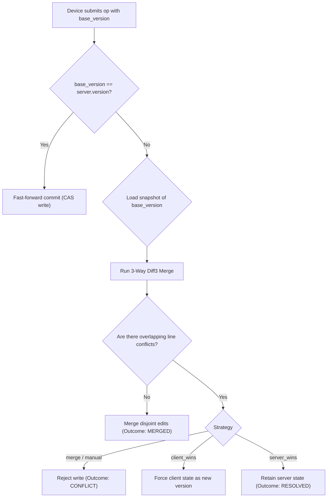

# SyncLab — Distributed Offline-First Sync Engine With ML Intelligence

<p align="left">
  
  
  
  
  
  
</p>

**SyncLab** is an enterprise-grade backend synchronization engine designed to resolve multi-device offline state conflicts without silent data overwrites. Built for **GDG on Campus SRM Technical Domain Recruitment (Backend & Distributed Systems Track)**, SyncLab integrates classic 3-way Diff3 merges, monotonic version tracking, and atomic Compare-And-Swap (CAS) transactions with cutting-edge innovations: **Real-Time WebSocket & SSE Broadcast Channels**, **ML Semantic Conflict Detection**, **FugueMax Sequence CRDTs**, **Prolly Tree Merkle Reconciliation**, and **Distributed Vector Clocks**.

---

## ⚡ Real-Time Demonstration Guide (Evaluator Quickstart)

SyncLab provides multiple zero-friction provisions to inspect and verify synchronization in **real-time**:

### Option 1: Animated Real-Time Terminal Simulator (Recommended)
Run the dedicated multi-device real-time simulator. It simulates a Laptop (MacBook Pro), Phone (iPhone 15), and Tablet going offline, editing concurrent buffers, experiencing network disconnects, and observing real-time Diff3 merges and conflict prevention:

```bash
# Auto Real-Time Mode (~1.0s pacing between device actions)
python scripts/demo_realtime.py

# Fast Execution Mode (~0.2s pacing)
python scripts/demo_realtime.py --fast

# Interactive Step-by-Step Mode (Press [Enter] to trigger each device action)
python scripts/demo_realtime.py --step
```

### Option 2: Live Web Studio & Conflict Simulator
Start the FastAPI server. The compiled interactive React Studio is served directly from the root path:

```bash
uvicorn app.main:app --host 127.0.0.1 --port 8000 --reload
```
- **Web Studio & Conflict Simulator:** Open [`http://127.0.0.1:8000`](http://127.0.0.1:8000)
- **Interactive Swagger UI:** Open [`http://127.0.0.1:8000/docs`](http://127.0.0.1:8000/docs)
- **ReDoc Documentation:** Open [`http://127.0.0.1:8000/redoc`](http://127.0.0.1:8000/redoc)

### Option 3: Live WebSocket Fleet Feed
Connect any WebSocket client (Postman, browser console, or wscat) to listen to sub-millisecond sync events as they happen:
```
ws://127.0.0.1:8000/ws/sync
```

### Option 4: Server-Sent Events (SSE) Live Stream
Stream live synchronization events directly in your terminal using `curl`:
```bash
curl -N http://127.0.0.1:8000/sync/realtime/stream
```

### Option 5: Comprehensive Automated Evaluator Script
```bash
python scripts/demo_synclab.py
```

---

## Key Highlights

- **Zero Silent Overwrites:** Stale writes with `base_version < current_version` are either merged field-by-field or acknowledged as explicit conflicts.
- **Real-Time WebSocket & SSE Broadcast:** Asynchronous `RealtimeHub` pushes `SYNC_ACCEPTED`, `SYNC_MERGED`, and `CONFLICT_DETECTED` events to connected devices.
- **3-Way Line Diff3 Merge:** Disjoint concurrent line modifications from offline devices merge automatically without data loss.
- **ML Semantic Contradiction Engine:** Identifies logical contradictions between non-overlapping edits and predicts merge failure probability.
- **FugueMax Sequence CRDT:** Implements maximal non-interleaving character total-ordering for real-time concurrent typing (Weidner & Kleppmann 2025).
- **Prolly Tree (Content-Defined Chunking):** Probabilistic B-Trees offering $O(\log N)$ Merkle diff set reconciliation.
- **Vector Clock Causal Ordering:** Full causal DAG relationship comparison (`IDENTICAL`, `ANCESTOR`, `DESCENDANT`, `CONCURRENT`).
- **Atomic Compare-And-Swap (CAS):** Race-condition proof database commits on version column.
- **Idempotency Lock:** Unique `op_id` ring-buffer ensures network duplicates return cached responses without re-executing writes.

---

## Table of Contents

- [1. Architecture & Repository Structure](#1-architecture--repository-structure)
- [2. Quickstart & Setup](#2-quickstart--setup)
- [3. Algorithmic Complexity Matrix](#3-algorithmic-complexity-matrix)
- [4. API Endpoints](#4-api-endpoints)
- [5. How Synchronization Works](#5-how-synchronization-works)
- [6. Machine Learning Domain Suite](#6-machine-learning-domain-suite)
- [7. Automated Testing & Verification](#7-automated-testing--verification)
- [8. Community Standards](#8-community-standards)

---

## 1. Architecture & Repository Structure

```
backend-offline-sync/
├── app/
│   ├── engine/
│   │   ├── fugue_crdt.py            # FugueMax CRDT with non-interleaving total order
│   │   ├── prolly_tree.py           # FastCDC Probabilistic Merkle B-Trees
│   │   ├── realtime_hub.py          # WebSocket & SSE real-time broadcast engine
│   │   ├── structured_ast_merge.py  # Markdown heading AST semantic merge
│   │   └── vector_clock.py          # Distributed Vector Clock causal DAG engine
│   ├── ml/
│   │   ├── __init__.py
│   │   └── service.py               # Semantic conflict detector & risk predictor
│   ├── routers/
│   │   ├── devices.py               # Device registry & catch-up delta feeds
│   │   ├── documents.py             # Document CRUD, version history, export.md
│   │   ├── realtime.py              # WebSockets, SSE streams & live simulation
│   │   └── sync.py                  # Core sync, batch, CRDT, Prolly & ML routes
│   ├── config.py                    # Environment settings
│   ├── db.py                        # SQLAlchemy session management
│   ├── main.py                      # FastAPI application with CORS & static UI mount
│   ├── models.py                    # SQLAlchemy ORM models
│   ├── obsidian.py                  # Obsidian YAML frontmatter markdown exporter
│   ├── schemas.py                   # Pydantic v2 validation contracts
│   ├── sync_engine.py               # 3-Way Diff3 line merge & scalar resolution
│   └── sync_service.py              # Atomic CAS writes, replay cache, versioning
├── frontend/                        # React TypeScript Studio with Conflict Simulator
├── static/                          # Production-built web assets served by FastAPI
├── scripts/
│   ├── demo_realtime.py             # Live Real-Time Multi-Device Terminal Simulator
│   └── demo_synclab.py              # Evaluator Invariant Verification Script
├── tests/                           # 39 Pytest unit & integration tests
├── CODE_OF_CONDUCT.md
├── CONTRIBUTING.md
├── LICENSE
├── SECURITY.md
└── requirements.txt
```

---

## 2. Quickstart & Setup

### Prerequisites
- Python 3.11+ (Python 3.14 fully verified)
- Node.js 18+ (only if rebuilding frontend from source; compiled assets are pre-bundled in `static/`)

### Installation
```bash
# Clone the repository
git clone https://github.com/kkm121/SyncLab.git
cd SyncLab

# Create and activate virtual environment
python -m venv .venv
source .venv/bin/activate  # On Windows: .venv\Scripts\activate

# Install dependencies
pip install -r requirements.txt
```

### Running the Live Server
```bash
uvicorn app.main:app --host 127.0.0.1 --port 8000 --reload
```
- Web Studio: [`http://127.0.0.1:8000`](http://127.0.0.1:8000)
- Interactive Swagger UI: [`http://127.0.0.1:8000/docs`](http://127.0.0.1:8000/docs)
- Health Check: `http://127.0.0.1:8000/health`

---

## 3. Algorithmic Complexity Matrix

| Routine / Endpoint | Time Complexity | Space Complexity | Underlying Invariant Guarantee |
| :--- | :--- | :--- | :--- |
| **POST /documents** (Create) | $O(1)$ | $O(B)$ | Monotonic version 1 audit creation |
| **GET /documents/{id}** (Read) | $O(1)$ amortized | $O(B)$ | Primary key index lookup |
| **POST /sync** (3-Way Diff3) | $O(L)$ | $O(L)$ | Longest Common Subsequence line diff |
| **POST /sync/ast-merge** (Markdown AST) | $O(S)$ | $O(S)$ | Structured AST block traversal |
| **POST /sync/fugue/simulate** (CRDT) | $O(M)$ | $O(M)$ | FugueMax non-interleaving order |
| **POST /sync/prolly/reconcile** (Tree Diff) | $O(\log N)$ | $O(\log N)$ | FastCDC content-defined chunking tree |
| **POST /sync/vector-clock/compare** | $O(D)$ | $O(D)$ | Component-wise causal DAG scan |
| **POST /documents/{id}/restore/{v}** | $O(1)$ | $O(B)$ | Point-in-time state resurrection |
| **WS /ws/sync** (Broadcast) | $O(C)$ | $O(1)$ | Fan-out to $C$ connected subscribers |

*Where $B$: document bytes, $L$: line count, $S$: AST sections, $M$: CRDT sequence length, $N$: Merkle entries, $D$: cluster devices, $C$: active WebSocket connections.*

---

## 4. API Endpoints

### Real-Time Channels
- `WS /ws/sync`: Bidirectional WebSocket endpoint for live fleet synchronization.
- `GET /sync/realtime/stream`: Server-Sent Events (SSE) live event stream.
- `GET /sync/realtime/history`: Fetch recent real-time broadcast event timeline.
- `POST /sync/realtime/simulate`: Run multi-stage real-time simulation scenario.

### Documents & History
- `POST /documents`: Create a new document (starts at version 1).
- `GET /documents/{id}`: Retrieve current state and active version.
- `GET /documents/{id}/versions`: Retrieve immutable point-in-time audit trail.
- `POST /documents/{id}/restore/{v}`: Point-in-time restoration without rewriting history.
- `GET /documents/{id}/export.md`: Export document as Obsidian-compatible Markdown with YAML frontmatter.

### Synchronization
- `POST /sync`: Execute a sync operation (`merge`, `client_wins`, `server_wins`, `manual`).
- `POST /sync/batch`: Atomic multi-operation sync queue flush for reconnecting devices.
- `POST /sync/batch-summary`: Summary statistics for batch operations.

### Cutting-Edge Systems & Machine Learning
- `POST /sync/vector-clock/compare`: Determine causality between distributed nodes.
- `POST /sync/fugue/simulate`: Simulate concurrent text editing with FugueMax CRDT.
- `POST /sync/prolly/reconcile`: Exchange content-defined Merkle trees in $O(\log N)$ steps.
- `POST /sync/ast-merge`: Section-aware 3-way AST merge for structured Markdown.
- `POST /sync/ml/analyze-conflict`: ML polarity contradiction and conflict risk scoring.

---

## 5. How Synchronization Works



---

## 6. Machine Learning Domain Suite

SyncLab uses scikit-learn and NLP routines for predictive sync management:
1. **Semantic Conflict Detector:** Evaluates sentiment, polarity, and negations across non-overlapping edits to catch logical contradictions.
2. **Conflict Risk Predictor:** Calibrated model computing the probability of conflict ($0.0 \to 1.0$) based on offline duration, edit volume, and Levenshtein divergence.
3. **Smart Merge Synthesizer:** Ranks potential merge strategies by semantic coherence.
4. **Sync Anomaly Detector:** Flags malformed payloads or anomalous synchronization frequencies.

---

## 7. Automated Testing & Verification

SyncLab maintains a **100% test pass rate** across 39 comprehensive tests:

```bash
# Run the test suite
python -m pytest -v
```

```
============================== 39 passed in 1.26s ==============================
```

---

## 8. Community Standards

SyncLab complies strictly with GitHub Community Standards:
- [Code of Conduct](CODE_OF_CONDUCT.md) (Contributor Covenant 2.1)
- [Contributing Guidelines](CONTRIBUTING.md)
- [Security Policy](SECURITY.md)
- [License](LICENSE) (MIT)
